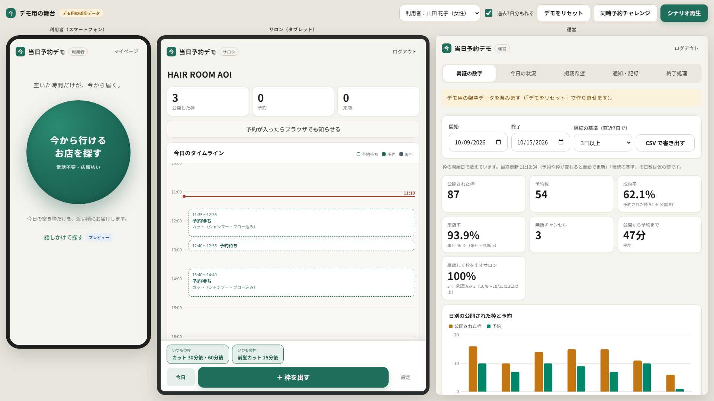

# 当日予約デモ（Next.js + Supabase）

「空いてしまった時間だけを、今から行きたい人へ届ける」当日・直前専用のマッチングのデモです。
サロンの予約管理システムではありません。今日の空き枠だけを扱い、利用者は大きなボタン1つから、今行ける枠を1タップで予約します（電話不要・店頭払い）。

店名・人物名・住所・電話番号はすべて架空です。実在するサービスの名前・ロゴ・画面・キャッチコピーは使っていません。

| 画面 | URL | 内容 |
|---|---|---|
| 利用者 | `/` | 大きなボタン → 時間帯 → 近い順に最大3件 → 予約の確認 → 予約確定（開始までの時間・地図・電話）→ アンケート |
| | `/signup` `/login` `/mypage` | 新規登録（メールのリンクで本人確認）・ログイン・マイページ（予約・履歴・カルテ・会話の好み・予約停止の再開日） |
| サロン | `/salon` | 今日のタイムライン、枠を出す（いつもの枠・複数の時刻）、予約の通知（画面・音・振動・ブラウザ通知）、予約の操作、店舗の設定、通知ログ |
| 運営 | `/admin` | 実証の数字（CSV）、全サロンの今日、予約停止中の電話番号、掲載希望の承認、通知ログ・操作記録、終了処理の試し実行 |
| 掲載申込 | `/apply` | サロン向けの公開フォーム |
| デモ用の舞台 | `/demo` | 3画面を並べた録画用の画面（`DEMO_MODE=true` のときだけ） |



---

## 仕組みの要点

- **書き込みはすべてデータベースの関数経由**（`SECURITY DEFINER`・`search_path` 固定・先頭で本人／所属／権限を確認）。画面側にはテーブルへの直接の書き込み権限を与えていません。閲覧範囲は RLS で決めています。
- **同時予約は二重に防ぎます**：`book_slot` は枠の行ロックに加え、利用者のプロフィール行もロックします。1つの枠に有効な予約は一意インデックスで1件だけ、1アカウントが同時に持てる予約も1件だけです（`has_active_booking`）。
- **時刻の判定は日本時間**。枠は今日の 9:00〜23:59 開始だけ。受付の締切はメニューごと（既定は開始10分前、カラーは3時間前など）。
- **利用者の現在地はサーバーに送りません**（距離は端末の中で計算。使わない場合は利用エリアの基準地点から）。
- **サロンに渡すのは第3章8の範囲だけ**（氏名・電話・メール・予約内容・カルテ・共有した写真1枚とメモ・会話の好み・予約メモ）。予約時点の写しを予約に保存し、サロンはプロフィールを直接読めません。性別・年代・職業・アンケート・位置情報は渡しません。
- **ヘア写真は非公開バケット**（`hair-photos`）。見られるのは本人と、写真を共有した予約のサロンだけ。表示は60秒で切れる署名付きURL。
- **`SUPABASE_SERVICE_ROLE_KEY` はサーバー側（`app/api`）とスクリプトだけ**で使います。画面側にパスワードや秘密の値は置いていません。

### 自動で動く仕組み

| 仕組み | どこで | 内容 |
|---|---|---|
| 時間切れの枠 | `expire_stale_slots()` を pg_cron で1分ごと | 締切を過ぎても予約のない枠を「受付終了（expired）」に。表示と予約の判定は時刻でも絞るので、遅れても誤りは起きません |
| 通知の送信 | トリガー → `notification_outbox` → `/api/notifications/dispatch` | 予約の成立・キャンセルを送信待ちに積み、`for update skip locked` で取り出して送信。結果と日時を記録し、二度送りません。送信のきっかけは「操作の直後」と「定期実行」の両方 |
| 予約停止と解除 | `suspension_until()` | 電話番号ごとに直近90日の無断キャンセルを数え、2回で停止。期間で判定するので解除の処理は不要。画面に再開日を表示 |
| 古い記録の削除 | `purge_old_records()` を pg_cron で毎日 | 90日を過ぎた無断キャンセルの記録を消す |
| 実証の数字 | `admin_metrics(from, to, min_days)` | すべて DB 内のデータから計算（画面に固定の数字はなし） |

通知は、キーがなければ「シミュレーション送信」として記録し、サロン・運営の通知ログで LINE 風・メール風のプレビューとして確認できます。
- サロンへの LINE（Messaging API のプッシュメッセージ、連絡用グループ宛て）：店舗名・日時・メニュー・金額・お名前のみ
- 利用者へのメール（Resend）：サロン都合のキャンセルのお知らせ。カルテ・写真・位置情報は載せません

---

## 動かし方

必要なもの：Node.js 20.6以上、Supabase のプロジェクト（無料プランで可・リージョンは Tokyo を推奨）

### 1. データベースを作る

Supabase の **SQL Editor** で、次の順に実行します（`psql` でも同じです）。

| 順 | ファイル | 内容 |
|---|---|---|
| 1 | `supabase/migrations/0001_init.sql` | テーブル・関数・RLS（最初の版） |
| 2 | `supabase/seed.sql` | デモ用のサロン・美容師・メニュー |
| 3 | `supabase/migrations/0002_rules.sql` | 業務ルール（締切・1アカウント1件・キャンセル理由・写し・写真・アンケート・同意・運営・掲載希望） |
| 4 | `supabase/migrations/0003_automation.sql` | 時間切れの処理・通知の送信待ち・実証の数字・終了処理の試し実行・pg_cron の登録 |
| 5 | `supabase/migrations/0004_demo.sql` | デモ用の関数（サーバー側からだけ呼べる） |
| 6 | `supabase/seed_0002.sql` | エリア・カラーのメニュー・アンケートの質問・いつもの枠 |

0002 以降は、既存のデータがあっても適用でき、2回流しても壊れません。

### 2. pg_cron と Storage を確かめる

0003 は、pg_cron が使える環境では自動で有効化して登録します。使えない場合はスキップして続行します（表示と予約は時刻でも絞るので、デモは動きます）。

- **pg_cron**：Dashboard → Database → Extensions で `pg_cron` を有効にしてから、0003 をもう一度流します。登録は次で確認できます。
  ```sql
  select jobname, schedule, command from cron.job;
  -- expire-stale-slots  * * * * *   … 1分ごと
  -- purge-old-records   15 18 * * * … 毎日 3:15（日本時間）
  ```
- **Storage**：0002 が非公開バケット `hair-photos` と3つのポリシーを作ります。Dashboard → Storage でバケットが **Public ではない** ことを確認してください。ポリシーを作る権限がないと表示された場合は、Storage → Policies で次と同じ内容を作ります。
  - INSERT（authenticated）：`bucket_id = 'hair-photos' and split_part(name, '/', 1) = auth.uid()::text`
  - SELECT（authenticated）：`bucket_id = 'hair-photos' and public.can_view_hair_photo(name)`
  - DELETE（authenticated）：`bucket_id = 'hair-photos' and split_part(name, '/', 1) = auth.uid()::text`
- **Realtime**：0001〜0003 が `slots`・`bookings`・`salon_applications`・`notification_outbox` を配信対象に加えます（Database → Publications → `supabase_realtime`）。

### 3. 環境変数

`.env.example` をコピーして `.env.local` を作ります（`.env.local` はコミットしません）。

| 変数 | 必須 | 用途 |
|---|---|---|
| `NEXT_PUBLIC_SUPABASE_URL` / `NEXT_PUBLIC_SUPABASE_ANON_KEY` | ○ | Project Settings → API |
| `SUPABASE_SERVICE_ROLE_KEY` | ○ | サーバー側の処理とスクリプトだけ。公開しない |
| `DEMO_PASSWORD` | ○ | デモ用アカウントの共通パスワード（サーバー側のデモログインとスクリプト） |
| `DEMO_MODE` | | `true` のときだけ `/demo` とデモ用の API が動く。本番は `false` |
| `CRON_SECRET` | | 通知の定期実行の合言葉（長いランダムな文字列） |
| `LINE_CHANNEL_ACCESS_TOKEN` | 任意 | LINE Messaging API。未設定ならシミュレーション送信 |
| `RESEND_API_KEY` / `MAIL_FROM` | 任意 | Resend。未設定ならシミュレーション送信 |
| `NEXT_PUBLIC_TERMS_URL` / `NEXT_PUBLIC_PRIVACY_URL` | 任意 | 登録画面から開く利用規約・プライバシーポリシー |

規約の版は `lib/profile-options.ts` の `TERMS_VERSION`（仮置き）です。公開中の規約の版に合わせて書き換えてください。

### 4. インストールとデモ用アカウント

```bash
npm install
npm run setup:demo
```

| 用途 | メールアドレス |
|---|---|
| サロンA（HAIR ROOM AOI）／B（atelier nagi）／C（Salon Komorebi・女性のみ） | salon-a@demo.test ／ salon-b@demo.test ／ salon-c@demo.test |
| 運営 | admin@demo.test |
| 利用者10人（年代・職業はばらばら。user1 山田 花子・女性、user2 鈴木 一郎・男性 ほか） | user1@demo.test 〜 user10@demo.test |

### 5. 起動する

```bash
npm run dev            # 開発
npm run build && npm start   # 本番と同じ形で確認
```

今日の空き枠は、`/demo` の「デモをリセット」で作ります（`supabase/demo_slots.sql` を流す方法も残しています）。今日の枠しか作れないため、日本時間の 9時〜22時ごろに行ってください。

### 6. 通知の定期実行（本番）

ローカルの `localhost` は Supabase から呼べないため、デモでは「予約・キャンセルの直後」と「サロン・運営の画面を開いている間の30秒ごと」に送信を頼んでいます。本番では次のどちらかで定期実行します。

- **Vercel Cron**：`vercel.json` に `{"crons":[{"path":"/api/notifications/dispatch","schedule":"* * * * *"}]}`。環境変数 `CRON_SECRET` を設定すると、Vercel が `Authorization: Bearer <CRON_SECRET>` を付けて GET で呼びます。
- **外部の cron**：`curl -H "Authorization: Bearer $CRON_SECRET" https://<ドメイン>/api/notifications/dispatch`

LINE は、公式アカウントの Messaging API チャネルを作り、チャネルアクセストークンを `LINE_CHANNEL_ACCESS_TOKEN` に設定します。サロンの連絡用グループにボットを招待し、そのグループ ID（`C` から始まる）をサロンの「設定」に入れます（LINE Notify は終了しているため使いません）。

### 7. 登録メール（カスタム SMTP）

Supabase 標準のメール送信は、送信数が少なく制限されています（デモ・確認用）。実際に登録を受け付ける前に、Authentication → Emails → SMTP Settings でカスタム SMTP（Resend など）を設定してください。

1. 送信元のドメインを SMTP サービスで認証する（SPF・DKIM）
2. Supabase に Host・Port・User・Password・Sender email を入れて保存する
3. Authentication → Rate Limits で、メールの送信上限を必要な数に上げる
4. Authentication → URL Configuration の Site URL と Redirect URLs に、公開する URL（`/login` を含む）を入れる

---

## 確認の方法

| コマンド | 確認すること | 必要なもの |
|---|---|---|
| `npm run lint` / `npm run typecheck` / `npm run build` | リンター・型・ビルド | — |
| `tests/local/run.sh` | DB のルールと権限 140 項目＋同時処理 3 項目（下記） | ローカルの PostgreSQL 16 以上 |
| `npm run test:race` | 10人が同じ枠に同時に予約 → 成立1件・「すでに埋まっています」9件 | Supabase |
| `npm run test:rls` | 権限の分離 15 項目 | Supabase |
| `npm run verify` | リセット → 枠の公開 → 予約（写真つき）→ Realtime → 通知 → キャンセル → 集計 → pg_cron（25 項目） | Supabase（アプリを起動していれば通知の送信まで） |

```bash
PSQL="psql -h localhost -p 5432 -U postgres" ./tests/local/run.sh
```

ローカルのテストは Supabase の auth・storage・ロールを最小限に再現して動かします（結果の例：`tests/local/result_example.txt`）。今日の枠を使うため、日本時間の 0時〜19時ごろに実行してください。対象：1アカウント1件、別々の枠への同時予約、メニューごとの締切、キャンセル理由ごとの扱い、時間切れの枠、通知の積み込みと二重送信の防止、アンケートと写真の見え方、運営の権限、終了処理の試し実行、マイグレーションの再実行など。

**ローカルで再現できないもの**（Storage の実ファイル・Realtime・pg_cron）は `npm run verify` で実際の Supabase で確かめます。手で確かめる場合は次のとおりです。
- Storage：利用者で写真つきで予約 → サロンの予約の詳細に写真が出る／別のサロンでは出ない
- Realtime：利用者が予約した瞬間に、サロンの画面に「新しい予約が入りました」が出る
- pg_cron：`select * from cron.job_run_details order by start_time desc limit 5;` で毎分の実行結果を見る

---

## 3分間のデモの手順

`DEMO_MODE=true` で起動し、ブラウザを全画面（1920×1080 推奨）にして `/demo` を開きます。左から利用者（スマホ）・サロン（タブレット）・運営の3画面が、それぞれのデモアカウントでログインした状態で並びます。

| 時間 | 操作 | 見せたいこと |
|---|---|---|
| 0:00〜0:15 | 「デモをリセット」（過去7日分も作る） | 今の時刻を基準に、今日の空き枠と状態がそろう。運営の数字も埋まる（デモ用の架空データと明記） |
| 0:15〜0:45 | サロン：「＋ 枠を出す」→ メニュー → 「30分後」「60分後」→ 公開 | 片手・数タップで、複数の枠をまとめて出せる。「いつもの枠」なら1タップ |
| 0:45〜1:20 | 利用者：大きなボタン → 「1時間以内」→ 近い順の3件 → 「予約」→ 「この内容で予約する」 | 電話不要・店頭払いで1タップ確定。開始までの時間が大きく出る。サロンの画面に「新しい予約が入りました」（音・振動つき） |
| 1:20〜1:40 | サロン：予約を開く → 「キャンセル」→「サロンの都合」 | 利用者の画面がその場で変わる。通知ログにメールのプレビュー（シミュレーション送信） |
| 1:40〜2:10 | 「同時予約チャレンジ」 | 10人が同時に予約しても成立は1件、9件は「すでに埋まっています」 |
| 2:10〜2:40 | 「シナリオ再生」 | 枠の公開 → 予約 → 通知 → 来店済み → 運営の数字が増える、が自動で流れる |
| 2:40〜3:00 | 運営：実証の数字 → 「CSV で書き出す」、「終了処理」→ 試し実行 | 成約率・来店率・継続して枠を出すサロンの割合などを DB から集計。終了時の削除・加工の対象件数 |

利用者のホームの「話しかけて探す」は将来構想のプレビューです（ブラウザの音声入力か文字入力。言葉の決まりで時間帯とメニューを読み取り、外部の AI は使いません）。

---

## ディレクトリ

```
supabase/
  migrations/0001_init.sql        最初の版（書き換えない）
  migrations/0002_rules.sql       業務ルール
  migrations/0003_automation.sql  自動で動く仕組み
  migrations/0004_demo.sql        デモ用の関数
  seed.sql / seed_0002.sql        デモ用データ
  demo_slots.sql                  今日の空き枠を手作業で作る（「デモをリセット」と同じ内容の簡易版）
app/
  page.tsx, book/, booking/, signup/, login/, mypage/   利用者
  salon/  admin/  apply/  demo/                          サロン・運営・掲載申込・デモ用の舞台
  api/notifications/dispatch   通知の送信（直後の呼び出し・定期実行）
  api/admin/approve            掲載希望の承認（スタッフのアカウント作成）
  api/demo/*                   デモ用（DEMO_MODE 以外は404）
components/  user/ salon/ admin/ demo/ と共通部品
lib/         時刻（日本時間）・エラー文言・通知の文面と送信・ログイン状態（役割ごとに保存先を分ける）
scripts/     setup-demo / race-test / rls-check / verify-all
tests/local/ ローカルの PostgreSQL での確認
docs/screens/ 画面イメージ
```

## 本番に向けて残っていること

- 運営によるサロンの位置（緯度・経度）と住所の登録画面（承認時は仮にエリアの基準地点を入れています）
- 実証終了時の削除・加工の本実行（デモは試し実行まで）
- 利用規約・プライバシーポリシーの本文と版の管理
- 通知の定期実行の設定（Vercel Cron など）と、LINE・Resend の本番キー
