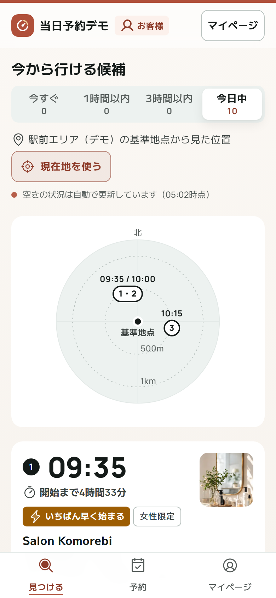

# 当日予約デモ（Next.js + Supabase）

「空いてしまった時間だけを、今から行きたい人へ届ける」当日・直前専用のマッチングのデモです。
サロンの予約管理システムではありません。今日の空き枠だけを扱い、利用者は大きなボタン1つから、今行ける枠を1タップで予約します（電話不要・店頭払い）。

店名・人物名・住所・電話番号はすべて架空です。実在するサービスの名前・ロゴ・画面・キャッチコピーは使っていません（例外は、ログイン・登録の「Google で続ける」「Yahoo! JAPAN IDで続ける」のボタンに、各社のガイドラインに沿って公式のアイコンを使っていることだけです）。

| 画面 | URL | 内容 |
|---|---|---|
| 利用者 | `/` | 大きなボタン → 時間帯 → 近い順に最大3件 → 予約の確認 → 予約確定（開始までの時間・地図・電話）→ アンケート |
| | `/signup` `/login` `/mypage` | 新規登録（Google・Yahoo! JAPAN ID、またはメールアドレス＋確認メールのリンク）・ログイン（タブを閉じても残る）・マイページ（カルテ・会話の好み・登録情報・予約停止の再開日・ログインの方法〔パスワード・外部 ID の連携と解除〕・アカウントの削除） |
| | `/bookings` | 予約（下のタブの「予約」）：現在の予約（開始までの時間・予約の画面へ）と予約の履歴。マイページとは分けている |
| | `/signup/complete` | 登録の仕上げ（外部 ID で登録した方が、予約に必要な電話番号・18歳以上の確認・規約への同意などを入力） |
| | `/auth/complete` | 確認メールのリンク・外部 ID から戻る先（ログインして、続きの画面へ進める） |
| | `/forgot` `/reset` | パスワードを忘れたとき（再設定のメール → 新しいパスワード。サロン・運営のアカウントも同じ） |
| サロン | `/salon` | 今日の予定（担当ごとの帯・時刻の順の一覧）、枠を出す（空いた時間から・時刻を選ぶ・いつもの枠）、予約の通知（画面全体・音・振動・ブラウザ通知）、予約の操作、今日はここまで、お店の情報と場所・メニュー・担当などの設定、通知ログ |
| | `/salon/signup` | サロンの新規登録（店名・お名前・メールアドレス・パスワード → 運営の承認 → 確認のリンクで登録完了 → 初期設定） |
| 運営 | `/admin` | 実証の数字（CSV）、全サロンの今日、予約停止中の電話番号、サロンの一覧（初期設定の進み具合・加わった日時）と掲載の停止・再開、掲載希望の承認・見送り、新しい掲載希望・新しく加わったサロンの知らせ、通知ログ・操作記録、運営メンバー（招待・外す・自分のログインの方法）、終了処理の試し実行 |
| 掲載申込 | `/apply` | サロン向けの問い合わせフォーム（アカウントを作らずに相談したい場合） |
| ご利用開始 | `/welcome` | 承認したサロンのスタッフ・招待された運営メンバーが、メールのリンクから開く（新規登録のサロンは、開くと登録が完了してログイン。パスワードのないアカウントは、ここで決める） |
| デモ用の認証画面 | `/auth/demo-provider` | 外部 ID のキーが未設定のデモで、Google・Yahoo! JAPAN ID での登録・ログインの流れを試す画面（各社の画面ではないと明示） |
| デモ用の舞台 | `/demo` | 3画面を並べた録画用の画面（`DEMO_MODE=true` のときだけ） |


---

## サロンの申込から削除まで

1. サロンが `/salon` の「新規登録」（`/salon/signup`）で、店名・お名前・メールアドレス・パスワードを入れて「登録する」を押す。アカウントは**確認前**の状態で作られ、運営の確認が済むまでログインできない（ログインしようとすると「運営の確認待ち」と出る）。この時点では確認のメールは送らない。確認待ちのあいだに申し込み直すと、新しい内容に置き換わる。Google・Yahoo! JAPAN ID で登録した場合や、すでにアカウントがある場合（お客様・ほかのお店のスタッフ）は、ログインしたまま店名とお名前を入れて申し込む（2店舗目も同じ）。アカウントを作らずに相談したい場合は `/apply` のフォームから。
2. 申込は運営の画面の「掲載希望」に届く。ログイン中に届いた申込はその場で知らせ、次にログインしたときは最初の画面で「新しい掲載希望が○件届いています」と知らせる。掲載希望のタブには承認待ちの件数が出る。
3. 運営が「承認して確認のリンクを送る」を押すと、お店を作って申し込んだアカウントをスタッフにし、登録のメールアドレスへ確認のリンクつきの「ご利用開始のご案内」を自動で送る（件名・宛名・挨拶・手順・登録内容・注意・署名の一般的な形。テキストと HTML の両方。文面は `lib/notify/format.ts`）。フォームからの申込は「承認してご案内を送る」で、スタッフのアカウントも作る。Resend のキーがなければシミュレーション送信として記録し、「通知・記録」で中身を確かめられる。見送ると「見送りのご連絡」を送り、新規登録で作った確認前のアカウントは消す（同じメールアドレスで申し込み直せる）。
4. サロンはリンク（`/welcome`）を開くと、メールアドレスの確認が済んで登録が完了し、サロンの画面にログインして3つの初期設定に進む。次回からは、申し込みのときに決めたパスワードでログインする（フォームからの申込・パスワードのないアカウントは、ここでパスワードを決める）。リンクは一度だけ使え、期限が切れたら運営が「ご案内メールをもう一度送る」で新しいリンクを送る。実際に送ったメールは、記録からリンクを消す。
5. 初期設定（受付中のメニューが1つ以上・担当・お店の住所と場所）を終えて「設定を終えて始める」を押すと、サロンの業務の画面（今日の予定・枠を出す）に進み、運営の画面に**「新しいサロンが加わりました」**と知らせる。運営が画面を開いていればその場で（緑の知らせ。「見る」でサロンの一覧へ）、開いていなければ次にログインした最初の画面で知らせ、「サロン」のタブに件数を出す（タブを開くと消える）。サロンの一覧には、そのお店に「新しく加わりました」と、加わった日時が出る。住所と場所を保存するまでは、設定を終えられない。知らせは初めて設定を終えたときの1回だけで、操作記録にも残る。
6. 掲載をやめるときは、運営が「掲載を止める」（いつでも再開できる）。止めると、そのサロンの公開中の枠をその場で取り下げ、利用者の画面（一覧・開いている確認シート・予約の確認ページ）からすぐに消える。表を直接読んでも見えず、予約もできない。すでに予約しているお客様には、来店と電話のためにお店の情報が表示され続ける。再開すると、取り下げた枠のうち受付の締切前のものを戻す。**削除は、予約の履歴がないサロンだけ**（申込の誤りやテスト用など）。予約の履歴があるサロンは、実証の数字とお客様の予約・無断キャンセルの記録を残すため削除できない。削除すると、そのサロンだけのスタッフのアカウントも消える。デモ用の3店は削除できない。

## 新規登録とログイン

| 誰が | 登録の方法 | ログインの方法 |
|---|---|---|
| 利用者 | `/signup`：**Google**・**Yahoo! JAPAN ID**（連携のあと、予約に必要な情報だけ入力）／**メールアドレス**（2段階の入力 → 「メールアドレスの確認のお願い」のリンクを開くと完了し、そのままログイン） | `/login`：外部 ID・メールアドレスとパスワード。マイページで外部 ID の連携・解除、パスワードの設定・変更 |
| サロン | `/salon/signup`：**店名・お名前・メールアドレス・パスワード**を入れて「登録する」→ 運営の「掲載希望」に届く（確認が済むまでログインできない）→ 運営が承認すると、登録のメールアドレスへ**確認のリンク**が自動で届く → リンクを開くと登録が完了してログインし、初期設定へ。見送ると「見送りのご連絡」。外部 ID・既存のアカウントでは、ログインしたまま申し込む。`/apply` の問い合わせフォームからの申込もこれまでどおり | `/salon`：外部 ID・メールアドレスとパスワード。設定のタブで連携・パスワード |
| 運営 | **公開の登録はなし**。既存の運営が「運営メンバー」のタブから招待する（新しい方にはパスワードを決めるリンク、既存のアカウントには運営の権限を加えて知らせる）。外すのも運営だけ（自分自身と最後の1人は外せない） | `/admin`：メールアドレスとパスワード、または**連携済みの**外部 ID（運営でない外部 ID ではアカウントも作らない） |

- 確認メール・登録済みのお知らせ・承認／見送りのお知らせ・運営への招待は、このサービスから送ります（Resend。未設定ならシミュレーション送信）。Supabase の標準メールの送信数の制限に左右されません。文面は `lib/notify/format.ts`。
- 登録済みのメールアドレスで登録しようとしたときは、画面には同じ案内を出し、本人に「登録済みのお知らせ」（ログインとパスワード再設定の案内）を送ります。外から登録の有無が分からないようにするためです。
- 外部 ID は、OpenID Connect の認可コードフロー（PKCE・state・nonce）で受け取り、ID トークンの署名・発行者・宛先・有効期限をサーバーで確かめます。キーはサーバーの環境変数だけに置きます。
- 外部 ID とアカウントの結びつけ：①連携済みならそのアカウント ②連携先で**確認済み**のメールアドレスと同じアカウントがあれば連携（確認前のアカウントだった場合は、乗っ取りを防ぐため、それまでのパスワードを無効にする）③どちらでもなければ新しく作る。パスワードのない外部 ID だけのアカウントは、最後の連携を外せません（締め出しを防ぐ）。
- **デモ（`DEMO_MODE=true`）でキーが未設定**のときは、ボタンに「デモ」と出し、デモ用の認証画面で流れを試せます。使えるのは例示用のメールアドレス（`@example.com`・`.test`）だけで、既存のアカウントとはメールアドレスで結びつけません。確認メールも送られないため、画面に「メールのリンクを開く（デモ）」を出します。**本番（`DEMO_MODE=false`）では、どちらも出ません。**
- ボタンのアイコンは各社の公式の素材をそのまま使っています（`public/brand/`。色・形は変えない）。Google は[ブランドガイドライン](https://developers.google.com/identity/branding-guidelines)の標準の「G」（白地・#747775 の枠・#1F1F1F の文字）、Yahoo! JAPAN は[ログインボタン デザインガイドライン](https://developer.yahoo.co.jp/yconnect/loginbuttons.html)の素材（赤 #ff0033 のアイコン。素材のダウンロードはガイドラインと注意事項への同意が前提）です。デモ用の認証画面には、各社のアイコンを出しません（各社の画面と見間違えないため）。

## 仕組みの要点

- **書き込みはすべてデータベースの関数経由**（`SECURITY DEFINER`・`search_path` 固定・先頭で本人／所属／権限を確認）。画面側にはテーブルへの直接の書き込み権限を与えていません。閲覧範囲は RLS で決めています。
- **同時予約は二重に防ぎます**：`book_slot` は枠の行ロックに加え、利用者のプロフィール行もロックします。1つの枠に有効な予約は一意インデックスで1件だけ、1アカウントが同時に持てる予約も1件だけです（`has_active_booking`）。
- **時刻の判定は日本時間**。枠は今日の 9:00〜23:59 開始だけ。受付の締切はメニューごと（既定は開始10分前、カラーは3時間前など）。
- **利用者の現在地はサーバーに送りません**（距離は端末の中で計算。使わない場合は利用エリアの基準地点から）。
- **サロンに渡すのは第3章8の範囲だけ**（氏名・電話・メール・予約内容・カルテ・共有した写真1枚とメモ・会話の好み・予約メモ）。予約時点の写しを予約に保存し、サロンはプロフィールを直接読めません。性別・年代・職業・アンケート・位置情報は渡しません。
- **ヘア写真は非公開バケット**（`hair-photos`）。見られるのは本人と、写真を共有した予約のサロンだけ。表示は60秒で切れる署名付きURL。
- **`SUPABASE_SERVICE_ROLE_KEY` はサーバー側（`app/api`）とスクリプトだけ**で使います。画面側にパスワードや秘密の値は置いていません。

### 自動で動く仕組み

| 仕組み | どこで | 内容 |
|---|---|---|
| 時間切れの枠 | `expire_stale_slots()` を pg_cron で1分ごと | 締切を過ぎても予約のない枠を「受付終了（expired）」に。表示と予約の判定は時刻でも絞るので、遅れても誤りは起きません |
| 通知の送信 | トリガー → `notification_outbox` → `/api/notifications/dispatch` | 予約の成立・キャンセルを送信待ちに積み、`for update skip locked` で取り出して送信。結果と日時を記録し、二度送りません。送信のきっかけは「操作の直後」と「定期実行」の両方 |
| 予約停止と解除 | `suspension_until()` | 電話番号ごとに直近90日の無断キャンセルを数え、2回で停止。期間で判定するので解除の処理は不要。画面に再開日を表示 |
| 古い記録の削除 | `purge_old_records()` を pg_cron で毎日 | 90日を過ぎた無断キャンセルの記録を消す |
| 実証の数字 | `admin_metrics(from, to, min_days)` | すべて DB 内のデータから計算（画面に固定の数字はなし） |

通知は、キーがなければ「シミュレーション送信」として記録し、サロン・運営の通知ログで LINE 風・メール風のプレビューとして確認できます。
- サロンへの LINE（Messaging API のプッシュメッセージ、連絡用グループ宛て）：店舗名・日時・メニュー・金額・お名前のみ
- 利用者へのメール（Resend）：サロン都合のキャンセルのお知らせ。カルテ・写真・位置情報は載せません

---

## 見た目と素材

- **トーン**は「澄んだ」「間に合う」「確か」。色・文字・余白・角丸・影・動き・アイコンの大きさは `app/styles/tokens.css` に、基本の値（例：`--teal-600`）と意味の値（例：`--color-action`・`--color-time`・`--radius-label`）の2段で置いています。画面の CSS は意味の値だけを使い、色や数値を直接書きません（`node scripts/check-css-tokens.mjs` で確かめられます）。
- **色**：主要な操作は青緑（`#1f6f5c` を軸に 50〜900 の段階）、受付締切が近いことを表す「時間の色」は琥珀（`#9d5d03`）。サロンの画面は藍、運営の画面は紫に切り替わります。文字と背景のコントラストは 4.5:1 以上。
- **ブランドの印**：時計の輪と琥珀の一切れ（今日の空いた時間）の形で、中をページごとに変えています（お客様＝針が次の空きを指す、サロン＝空いた一切れを外へ出す、運営＝時計の中に棒グラフ）。画面上部の印・ブラウザのタブのアイコン・ホーム画面のアイコンで同じ形です（`lib/brand-mark.ts`）。
- **背景の虹**：ページの背景（白い面の後ろ）に、ページの使い方に合わせた淡い虹を敷いています。お客様は斜めに画面いっぱい、サロンはタイムラインと同じ向きに横へ静かに、運営は上の端だけ（グラフの後ろは無地）。コントラストを高くする設定・強制カラー・印刷のときは無地になります（`docs/design-references.md` の 4-5）。
- **部品**：`components/ui`（ボタン・ラベル・価格・お知らせ・面・入力・切り替え・知らせ・写真・アイコン）と、部品ごとの CSS Modules。土台は `app/styles/base.css`（リセット・文字・リンク・フォーカスの輪郭・動きを減らす設定）。
- **参考にしたサイト**（minimo・Nailie Beauty・ホットペッパービューティー・楽天ビューティ）で確かめた値と、このサービスへの調整は `docs/design-references.md`。参考サイトのロゴ・サービス名・キャッチコピー・画像・フォント・CSS のコードは使っていません。
- **作り直しの前後**：`docs/screens/before`・`docs/screens/after`（390×844 と 1024×768、同じ状態）。

### 素材のライセンス

| 素材 | ライセンス | 場所 |
|---|---|---|
| Zen Kaku Gothic New（日本語の文字） | SIL Open Font License 1.1 | Google Fonts（`next/font/google` で読み込み、サイトから配信） |
| Manrope（時刻・金額・予約番号の数字） | SIL Open Font License 1.1 | 同上 |
| Phosphor Icons | MIT | `@phosphor-icons/react` |
| お店の写真（3店×3枚） | Unsplash License | `public/images/salons`（写真の URL・撮影者は `public/images/CREDITS.md`） |
| Google・Yahoo! JAPAN ID のアイコン | 各社のブランドガイドライン | `public/brand` |

## 動かし方

必要なもの：Node.js 20.6以上、Supabase のプロジェクト（無料プランで可・リージョンは Tokyo を推奨）

### 1. データベースを作る

Supabase の **SQL Editor** で、次の順に実行します（`psql` でも同じです）。

| 順 | ファイル | 内容 |
|---|---|---|
| 1 | `supabase/migrations/0001_init.sql` | テーブル・関数・RLS（最初の版） |
| 2 | `supabase/seed.sql` | デモ用のサロン・美容師・メニュー |
| 3 | `supabase/migrations/0002_rules.sql` | 業務ルール（締切・1アカウント1件・キャンセル理由・写し・写真・アンケート・同意・運営・掲載希望） |
| 4 | `supabase/migrations/0003_automation.sql` | 時間切れの処理・通知の送信待ち・実証の数字・終了処理の試し実行・pg_cron の登録 |
| 5 | `supabase/migrations/0004_demo.sql` | デモ用の関数（サーバー側からだけ呼べる） |
| 6 | `supabase/migrations/0005_ui.sql` | 予約番号・「今日はここまで」と元に戻す・枠のまとめて作成・いつもの空き方・サロンの初期設定 |
| 7 | `supabase/migrations/0006_polish.sql` | 検索結果に担当の名前・サロンの住所と位置の設定・運営によるサロンの掲載の停止と再開 |
| 8 | `supabase/migrations/0007_salon_lifecycle.sql` | 承認したサロンへの「ご利用開始のご案内」メール・ご案内の再送の記録・サロンの削除 |
| 9 | `supabase/migrations/0008_listing_visibility.sql` | 掲載を止めた・削除したサロンを利用者の画面に出さない（枠の取り下げと戻し・表の読み取りの制限・掲載の変化の知らせ） |
| 10 | `supabase/migrations/0009_registration.sql` | 新規登録：外部 ID とアカウントの結びつけ・サロンの自己登録と審査中の扱い（枠を出せない）・運営メンバーの一覧と外す・登録／審査／招待のメール |
| 11 | `supabase/migrations/0010_salon_multi.sql` | 1つのアカウントで複数のお店：掲載中のお店のスタッフ・運営・お客様のアカウントでも、別のお店（系列店・2店舗目）を申し込める（審査中の申し込みがある間は二重に申し込めない） |
| 12 | `supabase/migrations/0011_demo_anytime.sql` | デモのリセットを夜・早朝でも使えるようにする（9時より前なら9時以降に枠を作る。メニューの受付締切が長くても枠が消えない） |
| 13 | `supabase/migrations/0012_completion.sql` | 仕上げ：キャンセルで「今日はここまで」・掲載停止中のお店の枠を公開に戻さない、掲載中でないお店の「元に戻す」を断る、審査中・見送りのお店は承認を通して掲載、お店のエリアを必須、通知の送り直しに間をあける、デモのリセットで止めたデモ用のお店と無断キャンセルの記録を戻す、パスワード再設定のメール |
| 14 | `supabase/migrations/0013_salon_signup_approval.sql` | サロンの新規登録を運営の承認制に：ログイン中のアカウントでの申し込み（`salon_apply`：お店は承認のときに作る）と、自分の申し込みの状況（`my_salon_application`） |
| 15 | `supabase/migrations/0014_salon_joined.sql` | 新しいサロンが加わったことを運営に知らせる：初期設定を終えた日時、運営へのお知らせ（運営だけが読める・Realtime）、設定を終えるにはメニューとお店の住所が必要 |
| 16 | `supabase/seed_0002.sql` | エリア・カラーのメニュー・アンケートの質問・いつもの枠 |

0002 以降は、既存のデータがあっても適用でき、2回流しても壊れません。

### 2. pg_cron と Storage を確かめる

0003 は、pg_cron が使える環境では自動で有効化して登録します。使えない場合はスキップして続行します（表示と予約は時刻でも絞るので、デモは動きます）。

- **pg_cron**：Dashboard → Database → Extensions で `pg_cron` を有効にしてから、0003 をもう一度流します。登録は次で確認できます。
  ```sql
  select jobname, schedule, command from cron.job;
  -- expire-stale-slots  * * * * *   … 1分ごと
  -- purge-old-records   15 18 * * * … 毎日 3:15（日本時間）
  ```
- **Storage**：0002 が非公開バケット `hair-photos` と3つのポリシーを作ります。Dashboard → Storage でバケットが **Public ではない** ことを確認してください。ポリシーを作る権限がないと表示された場合は、Storage → Policies で次と同じ内容を作ります。
  - INSERT（authenticated）：`bucket_id = 'hair-photos' and split_part(name, '/', 1) = auth.uid()::text`
  - SELECT（authenticated）：`bucket_id = 'hair-photos' and public.can_view_hair_photo(name)`
  - DELETE（authenticated）：`bucket_id = 'hair-photos' and split_part(name, '/', 1) = auth.uid()::text`
- **Realtime**：0001〜0003 が `slots`・`bookings`・`salon_applications`・`notification_outbox` を配信対象に加えます（Database → Publications → `supabase_realtime`）。

### 3. 環境変数

`.env.example` をコピーして `.env.local` を作ります（`.env.local` はコミットしません）。

| 変数 | 必須 | 用途 |
|---|---|---|
| `NEXT_PUBLIC_SUPABASE_URL` / `NEXT_PUBLIC_SUPABASE_ANON_KEY` | ○ | Project Settings → API |
| `SUPABASE_SERVICE_ROLE_KEY` | ○ | サーバー側の処理とスクリプトだけ。公開しない |
| `DEMO_PASSWORD` | ○ | デモ用アカウントの共通パスワード（サーバー側のデモログインとスクリプト） |
| `DEMO_MODE` | | `true` のときだけ `/demo` とデモ用の API が動く。本番は `false` |
| `CRON_SECRET` | | 通知の定期実行の合言葉（長いランダムな文字列） |
| `LINE_CHANNEL_ACCESS_TOKEN` | 任意 | LINE Messaging API。未設定ならシミュレーション送信 |
| `RESEND_API_KEY` / `MAIL_FROM` | 任意 | Resend。未設定ならシミュレーション送信 |
| `MAIL_REPLY_TO` | 任意 | メールの返信先（運営事務局の問い合わせ先） |
| `APP_URL` | 任意 | 公開する URL。メールの中のリンクと、外部 ID の戻り先に使う（未設定なら、そのとき開いていた URL）。本番では必ず設定 |
| `GOOGLE_CLIENT_ID` / `GOOGLE_CLIENT_SECRET` | 任意 | Google でのログイン（下の「8.」）。未設定なら、デモではデモ用の認証画面、本番ではボタンを出さない |
| `YAHOO_JAPAN_CLIENT_ID` / `YAHOO_JAPAN_CLIENT_SECRET` | 任意 | Yahoo! JAPAN ID でのログイン（下の「8.」）。扱いは Google と同じ |
| `AUTH_FLOW_SECRET` | 任意 | 外部 ID の手続き中の情報に付ける署名の鍵（長いランダムな文字列）。未設定なら `SUPABASE_SERVICE_ROLE_KEY` から作る |
| `NEXT_PUBLIC_TERMS_URL` / `NEXT_PUBLIC_PRIVACY_URL` | 任意 | 登録画面から開く利用規約・プライバシーポリシー |
| `NEXT_PUBLIC_PICK_MODE` | 任意 | 【提案】候補3件の選び方。`roles`（既定：いちばん早く始まる・いちばん近い・もうひとつの候補）／`nearest`（近い順） |
| `NEXT_PUBLIC_SHOW_DEPARTURE` | 任意 | 【提案】予約確定画面の「○時○分ごろに出れば間に合います」。`false` で出さない |
| `NEXT_PUBLIC_SHOW_BOOKING_NO` | 任意 | 【提案】予約番号の表示（利用者・サロン）。`false` で出さない（番号は DB で振り続ける） |
| `NEXT_PUBLIC_EMPTY_WATCH` | 任意 | 【提案】空きがないときの「空きが出たらお知らせします」。`false` で出さない |
| `NEXT_PUBLIC_SALON_ACHIEVEMENT` | 任意 | 【提案】サロンの画面上部の「今日、空き時間から生まれた予約」。`false` で出さない |
| `NEXT_PUBLIC_OVERDUE_MINUTES` | 任意 | 来店の記録がまだの予約を知らせるまでの分数（既定 15・仮の値） |

規約の版は `lib/profile-options.ts` の `TERMS_VERSION`（仮置き）です。公開中の規約の版に合わせて書き換えてください。

### 4. インストールとデモ用アカウント

```bash
npm install
npm run setup:demo
```

| 用途 | メールアドレス |
|---|---|
| サロンA（HAIR ROOM AOI）／B（atelier nagi）／C（Salon Komorebi・女性のみ） | salon-a@demo.test ／ salon-b@demo.test ／ salon-c@demo.test |
| 運営 | admin@demo.test |
| 利用者10人（年代・職業はばらばら。user1 山田 花子・女性、user2 鈴木 一郎・男性 ほか） | user1@demo.test 〜 user10@demo.test |

### 5. 起動する

```bash
npm run dev            # 開発
npm run build && npm start   # 本番と同じ形で確認
```

今日の空き枠は、`/demo` の「デモをリセット」で作ります（`supabase/demo_slots.sql` を流す方法も残しています）。枠は今日の 9:00〜23:59 開始だけなので、9時より前（夜・早朝）にリセットした場合は、9時以降の枠を作ります。23時ごろを過ぎると、作れる枠が少なくなります。

### 6. 通知の定期実行（本番）

ローカルの `localhost` は Supabase から呼べないため、デモでは「予約・キャンセルの直後」と「サロン・運営の画面を開いている間の30秒ごと」に送信を頼んでいます。本番では次のどちらかで定期実行します。

- **Vercel Cron**：`vercel.json` に `{"crons":[{"path":"/api/notifications/dispatch","schedule":"* * * * *"}]}`。環境変数 `CRON_SECRET` を設定すると、Vercel が `Authorization: Bearer <CRON_SECRET>` を付けて GET で呼びます。
- **外部の cron**：`curl -H "Authorization: Bearer $CRON_SECRET" https://<ドメイン>/api/notifications/dispatch`
- **Railway**：Railway の cron は最短5分間隔です。毎分送る場合は、Supabase の pg_cron と pg_net から上の URL を呼ぶか、外部の cron を使います（下の「9.」）。

LINE は、公式アカウントの Messaging API チャネルを作り、チャネルアクセストークンを `LINE_CHANNEL_ACCESS_TOKEN` に設定します。サロンの連絡用グループにボットを招待し、そのグループ ID（`C` から始まる）をサロンの「設定」に入れます（LINE Notify は終了しているため使いません）。

### 7. メールの送信（Resend とカスタム SMTP）

新規登録の確認・登録済みのお知らせ・審査の結果・運営への招待・ご利用開始のご案内は、このサービスから Resend で送ります（`RESEND_API_KEY` と `MAIL_FROM`）。パスワードの再設定（`/forgot`）のメールも、このサービスから送ります（一度だけ使えるリンク。利用者・サロン・運営のどの役割でも、その役割の画面で確かめる）。Supabase 標準のメール送信（送信数が少なく制限されている）は使いませんが、Supabase の画面から直接送る場合に備えて、Authentication → Emails → SMTP Settings でカスタム SMTP（Resend など）を設定しておくと安心です。

1. 送信元のドメインを SMTP サービスで認証する（SPF・DKIM）
2. Supabase に Host・Port・User・Password・Sender email を入れて保存する
3. Authentication → Rate Limits で、メールの送信上限を必要な数に上げる
4. Authentication → URL Configuration の Site URL と Redirect URLs に、公開する URL（`/login` と、パスワード再設定の `/reset` を含む）を入れる

携帯電話会社のメール（キャリアメール）は、送信元のドメインの認証（SPF・DKIM・DMARC）が整っていないと届かないことがあります。送信元のドメインの認証を済ませてください。

### 8. Google・Yahoo! JAPAN ID でのログイン（本番）

どちらも、各社の開発者向けの画面でアプリを登録し、**リダイレクト URI**（戻り先）に次を登録して、表示されたクライアント ID とシークレットを環境変数に入れます。`APP_URL` は公開する URL（`https://`）にしてください。

| | 登録する場所 | リダイレクト URI | 環境変数 |
|---|---|---|---|
| Google | Google Cloud Console → API とサービス → OAuth 同意画面（スコープは `openid` `email` `profile`）→ 認証情報 → OAuth クライアント ID（ウェブ アプリケーション） | `{APP_URL}/api/auth/callback/google` | `GOOGLE_CLIENT_ID` / `GOOGLE_CLIENT_SECRET` |
| Yahoo! JAPAN ID | Yahoo!デベロッパーネットワーク → アプリケーションの管理 → 新しいアプリケーションを開発（ID連携 v2・サーバーサイド。スコープは `openid` `email` `profile`） | `{APP_URL}/api/auth/callback/yahoo` | `YAHOO_JAPAN_CLIENT_ID` / `YAHOO_JAPAN_CLIENT_SECRET` |

- 設定してアプリを起動し直すと、ボタンの「デモ」の表示が消え、本物の認証画面に切り替わります（キーは画面側には出ません）。
- 開発中に `http://localhost:3000` で試す場合は、その URL のリダイレクト URI も登録します（登録できる URL の条件は、各社の案内を確認してください）。
- Google の OAuth 同意画面は、公開前は「テスト」状態で、登録したテストユーザーだけがログインできます。
- この方法は Supabase の外部ログインの設定を使いません（サーバーで受け取り、Supabase のアカウントに結びつけます）。Supabase 側の Providers の設定は不要です。

### 9. Railway に公開する（デモ）

上の「1.」〜「4.」（データベース・環境変数・デモ用アカウント）を済ませた Supabase を、そのまま使います。設定ファイルは要りません（Railway が Next.js を判別し、`npm run build` → `npm run start` で動かします。Node は `package.json` の `engines` で 22）。

1. Railway で **New Project → Deploy from GitHub repo** を選び、このリポジトリを選ぶ
2. サービスの **Variables** に環境変数を入れる。`NEXT_PUBLIC_` で始まるものはビルドのときに画面のコードへ埋め込まれるため、最初のビルドの前に入れる（変えたときは Redeploy で作り直す）

   | 変数 | 値 |
   |---|---|
   | `NEXT_PUBLIC_SUPABASE_URL` / `NEXT_PUBLIC_SUPABASE_ANON_KEY` | `.env.local` と同じ |
   | `SUPABASE_SERVICE_ROLE_KEY` | `.env.local` と同じ（Railway の Variables だけに入れる。コミットしない） |
   | `DEMO_MODE` | `true`（`/demo` とワンタップのデモログインを使う） |
   | `DEMO_PASSWORD` | `npm run setup:demo` を流したときと同じ値 |
   | `APP_URL` | 手順3で作る URL（`https://〜.up.railway.app`） |
   | `CRON_SECRET` / `AUTH_FLOW_SECRET` | 任意。長いランダムな文字列 |

3. **Settings → Networking → Generate Domain** で URL を作り、`APP_URL` に入れて Redeploy する
4. Supabase の **Authentication → URL Configuration** で、Site URL と Redirect URLs にその URL（`/login`・`/reset` を含む）を入れる
5. `https://〜.up.railway.app/demo` を開き、「デモをリセット」で今日の空き枠を作ってから見せる

注意：

- **サーバーの台数は1つのまま**にする（短い時間に何度も送れないようにする制限を、サーバーのメモリで数えているため）。
- **DEMO_MODE=true の間は、URL を知っている人は誰でも**、利用者・サロン・運営にワンタップでログインでき、データのリセットや運営メンバーの招待もできます。URL は見せる相手にだけ伝え、見せ終わったら `DEMO_MODE=false` にするか、Railway のサービスを止めてください。運用に切り替えるときは、デモ用アカウントのパスワード（`DEMO_PASSWORD`）を新しい値に変えてください。
- 通知（メール・LINE）は、キーを入れなければシミュレーション送信です（中身は運営の画面の「通知・記録」で見られます）。予約の直後と、サロン・運営の画面を開いている間に送るため、デモでは定期実行がなくても届きます。

---

## 確認の方法

| コマンド | 確認すること | 必要なもの |
|---|---|---|
| `npm run lint` / `npm run typecheck` / `npm run build` | リンター・型・ビルド | — |
| `npm run test:unit` | 候補の選び方・空き時間の切り分け・徒歩の目安・方位・外部 ID の ID トークンの検証と手続きの署名・移動先の制限（28 項目） | — |
| `tests/local/run.sh` | DB のルールと権限（T0〜T51）＋同時処理 4 項目（下記） | ローカルの PostgreSQL 16 以上 |
| `npm run test:race` | 10人が同じ枠に同時に予約 → 成立1件・「すでに埋まっています」9件 | Supabase |
| `npm run test:rls` | 権限の分離 24 項目（登録・外部 ID の連携の情報・運営へのお知らせを含む） | Supabase |
| `npm run test:a11y` | 主要な画面のアクセシビリティ（axe・WCAG 2.1 A／AA）。お客様・サロン・運営の画面と、予約の確認シート・予約確定・予約の知らせ | 起動中のアプリ（DEMO_MODE=true）・Chrome |
| `node scripts/check-css-tokens.mjs` | 画面の CSS に色や数値を直接書いていないか | — |
| `npm run verify` | リセット → 枠の公開 → 予約（写真つき）→ Realtime → 通知 → キャンセル → 集計 → pg_cron（25 項目） | Supabase（アプリを起動していれば通知の送信まで） |

```bash
PSQL="psql -h localhost -p 5432 -U postgres" ./tests/local/run.sh
```

ローカルのテストは Supabase の auth・storage・ロールを最小限に再現して動かします（結果の例：`tests/local/result_example.txt`）。今日の枠を使うため、日本時間の 0時〜19時ごろに実行してください。対象：1アカウント1件、別々の枠への同時予約、メニューごとの締切、キャンセル理由ごとの扱い、時間切れの枠、通知の積み込みと二重送信の防止、アンケートと写真の見え方、運営の権限、終了処理の試し実行、マイグレーションの再実行など。

**ローカルで再現できないもの**（Storage の実ファイル・Realtime・pg_cron）は `npm run verify` で実際の Supabase で確かめます。手で確かめる場合は次のとおりです。
- Storage：利用者で写真つきで予約 → サロンの予約の詳細に写真が出る／別のサロンでは出ない
- Realtime：利用者が予約した瞬間に、サロンの画面に「新しい予約が入りました」が出る
- pg_cron：`select * from cron.job_run_details order by start_time desc limit 5;` で毎分の実行結果を見る

---

## 画面イメージ（docs/screens）

見た目の作り直しの前後を、同じ状態で 390×844（スマートフォン）と 1024×768（タブレット横向き）で撮っています（`docs/screens/before`・`docs/screens/after`）。

| 利用者 | サロン |
|---|---|
| `user-home-*`（ホーム）・`user-candidates-*`（候補3件と距離レーダー）・`user-sheet-*`（写真つきの予約の確認シート）・`user-booked-*`（予約確定と予約番号のチケット） | `salon-incoming-*`（予約の知らせ）・`salon-today-*`（今日のタイムライン・担当ごとの帯） |



## 3分間のデモの手順

`DEMO_MODE=true` で起動し、ブラウザを全画面（1920×1080 推奨）にして `/demo` を開きます。左から利用者（スマホ）・サロン（タブレット）・運営の3画面が、それぞれのデモアカウントでログインした状態で並びます。

| 時間 | 操作 | 見せたいこと |
|---|---|---|
| 0:00〜0:15 | 「デモをリセット」（過去7日分も作る） | 今の時刻を基準に、今日の空き枠と状態がそろう。運営の数字も埋まる（デモ用の架空データと明記） |
| 0:15〜0:45 | サロン：「＋ 枠を出す」→ メニュー → 「30分後」「60分後」→ 公開 | 片手・数タップで、複数の枠をまとめて出せる。「いつもの枠」なら1タップ |
| 0:45〜1:20 | 利用者：大きなボタン → 「1時間以内」→ 近い順の3件 → 「予約」→ 「この内容で予約する」 | 電話不要・店頭払いで1タップ確定。開始までの時間が大きく出る。サロンの画面に「新しい予約が入りました」（音・振動つき） |
| 1:20〜1:40 | サロン：予約を開く → 「キャンセル」→「サロンの都合」 | 利用者の画面がその場で変わる。通知ログにメールのプレビュー（シミュレーション送信） |
| 1:40〜2:10 | 「同時予約チャレンジ」 | 10人が同時に予約しても成立は1件、9件は「すでに埋まっています」 |
| 2:10〜2:40 | 「シナリオ再生」 | 枠の公開 → 予約 → 通知 → 来店済み → 運営の数字が増える、が自動で流れる |
| 2:40〜3:00 | 運営：実証の数字 → 「CSV で書き出す」、「終了処理」→ 試し実行 | 成約率・来店率・継続して枠を出すサロンの割合などを DB から集計。終了時の削除・加工の対象件数 |

利用者のホームの「話しかけて探す」は将来構想のプレビューです（ブラウザの音声入力か文字入力。言葉の決まりで時間帯とメニューを読み取り、外部の AI は使いません）。

---

## ディレクトリ

```
supabase/
  migrations/0001_init.sql        最初の版（書き換えない）
  migrations/0002_rules.sql       業務ルール
  migrations/0003_automation.sql  自動で動く仕組み
  migrations/0004_demo.sql        デモ用の関数
  seed.sql / seed_0002.sql        デモ用データ
  demo_slots.sql                  今日の空き枠を手作業で作る（「デモをリセット」と同じ内容の簡易版）
app/
  page.tsx, book/, booking/, bookings/, signup/, login/, mypage/   利用者
  salon/  admin/  apply/  demo/                          サロン・運営・掲載申込・デモ用の舞台
  api/notifications/dispatch   通知の送信（直後の呼び出し・定期実行）
  api/admin/approve            掲載希望の承認（新規登録はお店を作って確認のリンクを送る、フォームはスタッフのアカウントも作る）
  api/admin/reject             掲載希望の見送り（見送りのご連絡）
  api/admin/invite-admin       運営メンバーの招待
  api/auth/signup・resend      メールアドレスでの新規登録と確認メールの再送
  api/auth/oauth/start         外部 ID の手続きを始める（state・nonce・PKCE を署名つきの Cookie に）
  api/auth/callback/[provider] Google・Yahoo! JAPAN ID から戻る先（ID トークンの検証 → アカウントの結びつけ）
  api/auth/oauth/demo          デモ用の認証画面からの送信（DEMO_MODE かつキー未設定のときだけ）
  api/auth/identities          連携の一覧と解除
  api/demo/*                   デモ用（DEMO_MODE 以外は404）
components/  user/ salon/ admin/ demo/ と共通部品
lib/         時刻（日本時間）・エラー文言・通知の文面と送信・ログイン状態（役割ごとに保存先を分ける）
scripts/     setup-demo / race-test / rls-check / verify-all
tests/local/ ローカルの PostgreSQL での確認
docs/screens/ 画面イメージ
```

## 本番に向けて残っていること

- 運営によるサロンの位置（緯度・経度）と住所の登録画面（承認時は仮にエリアの基準地点を入れています）
- 実証終了時の削除・加工の本実行（デモは試し実行まで）
- 利用規約・プライバシーポリシーの本文と版の管理
- 通知の定期実行の設定（Vercel Cron など）と、LINE・Resend の本番キー
- Google・Yahoo! JAPAN ID の本番のクライアント ID とシークレット、`APP_URL`。公開前に、ボタンの見た目が各社のガイドラインの最新版に合っているかを確かめる
- 回数制限（登録・確認メールの再送・外部 ID の開始）はサーバーのメモリ内の簡易版。複数台で動かす場合は共有の保存先（Redis など）に置き換える
